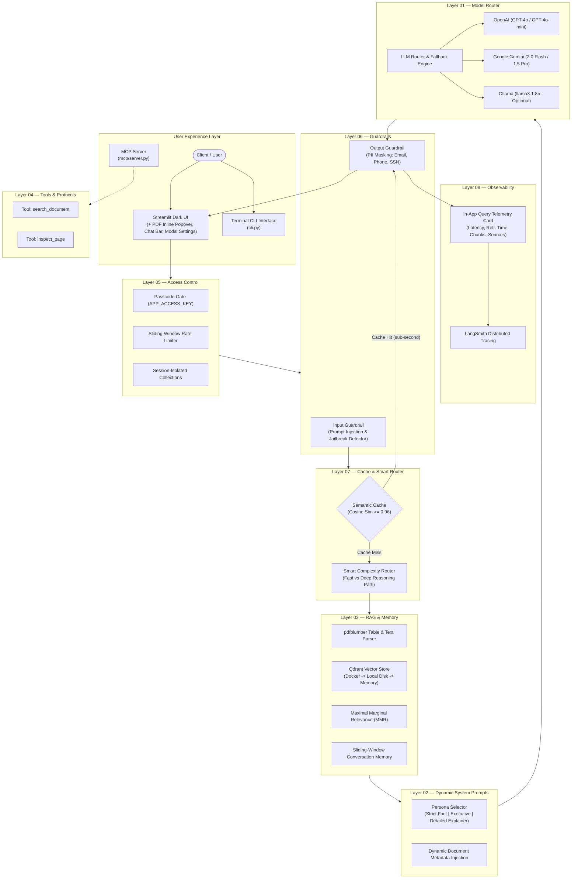
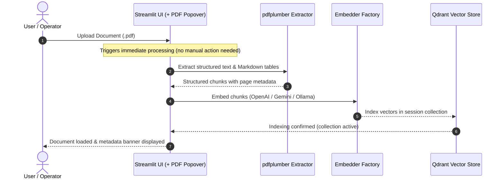
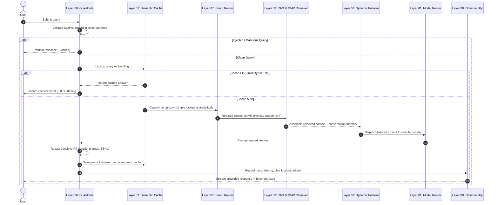
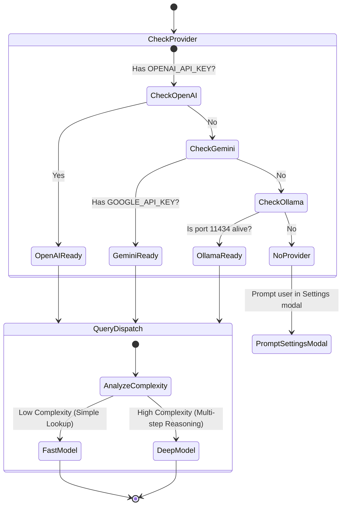

# Enterprise Semantic Document RAG

<div align="center">


-8A2BE2?style=for-the-badge)


**A hardened, production-grade 8-Layer Enterprise AI Agent Stack for semantic document retrieval, extraction, and synthesis.**

[Architecture](#system-architecture) • [Data Flow](#end-to-end-execution-flow) • [Features](#the-8-layer-production-stack) • [Quickstart](#getting-started) • [MCP Server](#mcp-server-integration) • [Telemetry](#observability--telemetry)

</div>

---

```
  ____                             _   _        ____      _     ____ 
 / ___|  ___ _ __ ___   __ _ _ __ | |_(_) ___  |  _ \    / \   / ___|
 \___ \ / _ \ '_ ` _ \ / _` | '_ \| __| |/ __| | |_) |  / _ \ | |  _ 
  ___) |  __/ | | | | | (_| | | | | |_| | (__  |  _ <  / ___ \| |_| |
 |____/ \___|_| |_| |_|\__,_|_| |_|\__|_|\___| |_| \_\/_/   \_\\____|
```

---

## Overview

**Enterprise Semantic Document RAG** is a resilient document intelligence platform built on top of the complete **8-Layer AI Agent Stack**. It enables high-accuracy question answering, multi-page synthesis, and structural table extraction over complex PDF documents.

Key operational characteristics:
- **Zero-Friction Ingestion:** Documents are parsed with `pdfplumber` (preserving tables & layout) and vectorized immediately upon upload.
- **Provider Agnostic:** Run locally with Ollama or in the cloud with OpenAI or Google Gemini. Ollama is **never required** when an API key is present.
- **Embedded Resilience:** 3-tier vector storage automatically routes between Docker Qdrant, local disk persistence (`./qdrant_data`), and in-memory fallback.
- **Agentic Extensibility:** Ships with an official Model Context Protocol (MCP) server for integration into Claude Desktop, Cursor, or custom multi-agent swarms.
- **Enterprise Hardened:** Integrated input injection defense, output PII redaction, sliding-window rate limiting, and sub-second cosine semantic caching.

---

## System Architecture

The platform is designed around 8 decoupled, testable layers:



---

## End-to-End Execution Flow

### 1. Document Ingestion Pipeline



### 2. Query Answering & Synthesis Flow



---

## The 8-Layer Production Stack

| Layer | Component | Implementation | Production Value |
|---|---|---|---|
| **01** | **Model Router** | `rag_pdf/llm_router.py` | Multi-cloud fallback across OpenAI, Gemini, and Ollama. Dynamic key loading with zero hard dependencies. |
| **02** | **System Prompts** | `rag_pdf/prompts.py` | 3 distinct personas (*Strict Fact-Based*, *Executive Summary*, *Detailed Explainer*) with dynamic document metadata injection. |
| **03** | **RAG & Memory** | `rag_pdf/retriever.py`<br>`rag_pdf/memory.py`<br>`rag_pdf/vector_store.py` | Maximal Marginal Relevance (MMR) retrieval, `pdfplumber` table extraction, and sliding-window conversation memory. |
| **04** | **Tools & MCP** | `rag_pdf/tools.py`<br>`mcp/server.py` | LangChain tools (`search_document`, `inspect_page`) and standard MCP stdio endpoint for external AI agents. |
| **05** | **Access Control** | `rag_pdf/auth.py` | Optional passcode gate, per-session sliding-window rate limiting, and per-user collection isolation. |
| **06** | **Guardrails** | `rag_pdf/guardrails.py` | Regex-based prompt injection and jailbreak detection on inputs; regex-based PII redaction on outputs. |
| **07** | **Cache & Router** | `rag_pdf/cache.py`<br>`rag_pdf/smart_router.py` | Cosine similarity semantic cache delivering sub-second response on duplicate/similar questions; complexity classifier. |
| **08** | **Observability** | `rag_pdf/observability.py` | Native LangSmith distributed tracing and real-time UI telemetry cards detailing response time, retrieval time, and chunk sources. |

---

## LLM State & Routing Logic



---

## User Interface & Ergonomics

The application interface is styled with a sleek, minimalist dark theme and strictly zero emojis:

- **Inline Upload Popover:** A compact `+ PDF` button is positioned directly adjacent to the chat input bar, keeping document attachment intuitive and immediate.
- **Automatic Ingestion:** Documents parse and vectorize the moment they are selected—no redundant "Process Document" button.
- **Modal Settings Dialog:** Configure OpenAI or Google Gemini API keys and select models inside an overlay dialog without resetting active conversation state.
- **Query Telemetry Cards:** Each assistant response provides an expandable metadata breakdown detailing execution duration, vector search latency, retrieved chunks, and source pages.

---

## Getting Started

### 1. Installation

Clone the repository and install dependencies:

```bash
git clone https://github.com/swastiek/semantic-document-rag.git
cd semantic-document-rag

# Create and activate virtual environment
python3 -m venv .venv
source .venv/bin/activate

# Install required packages
pip install -r requirements.txt
```

### 2. Configure Environment (Optional)

You can provide API keys via a `.env` file or enter them directly inside the app's **Settings** modal:

```env
# Cloud Model Providers (provide at least one)
OPENAI_API_KEY=sk-...
GOOGLE_API_KEY=AIza...

# Optional: Access Gate (Layer 05)
APP_ACCESS_KEY=your_secret_passcode

# Optional: LangSmith Tracing (Layer 08)
LANGCHAIN_TRACING_V2=true
LANGCHAIN_API_KEY=lsv2_pt_...
LANGCHAIN_PROJECT=semantic-document-rag
```

### 3. Launch Streamlit Application

```bash
streamlit run app.py
```

Navigate to `http://localhost:8501` in your browser.

---

## MCP Server Integration

This repository includes a standard **Model Context Protocol (MCP)** server (`mcp/server.py`), allowing external agents (e.g. Claude Desktop, Cursor, or LangGraph swarms) to query your indexed documents.

### Claude Desktop Configuration

Add the following to your `claude_desktop_config.json` (located at `~/Library/Application Support/Claude/claude_desktop_config.json` on macOS):

```json
{
  "mcpServers": {
    "semantic-rag": {
      "command": "python3",
      "args": [
        "/absolute/path/to/semantic-document-rag/mcp/server.py"
      ],
      "env": {
        "OPENAI_API_KEY": "your-key-here",
        "GOOGLE_API_KEY": "your-key-here"
      }
    }
  }
}
```

The server exposes two tools:
- `search_document(query, k=4)`: Semantically queries the vector database using MMR.
- `inspect_page(page_number)`: Retrieves the raw full text and tables for a given page.

---

## CLI Interface

For headless environments or automated scripting, query documents directly from the terminal:

```bash
# Ingest and query from command line
python3 cli.py --pdf path/to/document.pdf --query "Summarize the primary conclusions"
```

---

## Automated Test Suite

The 8-layer architecture includes a comprehensive unit test suite:

```bash
python3 -m unittest tests/test_stack.py
```

Test coverage includes:
- Multi-provider fallback and lazy import handling
- Dynamic system prompt construction and metadata injection
- Cosine semantic cache insertion and retrieval thresholds
- Prompt injection detection and PII redaction filters
- Sliding-window conversation memory tracking
- Sliding-window rate limiter enforcement
- LangSmith query telemetry encapsulation

---

## Project Structure

```
semantic-document-rag/
├── app.py                         # Streamlit UI & 8-Layer Orchestrator
├── cli.py                         # Terminal CLI query runner
├── requirements.txt               # Project dependencies
├── docker-compose.yml             # Optional Qdrant container definition
├── .gitignore                     # Git exclusion rules (safeguarding data/keys)
├── readme.md                      # Architecture, specifications & guide
├── rag_pdf/
│   ├── __init__.py                # Package facade
│   ├── llm_router.py              # Layer 01: Cloud/local model router
│   ├── prompts.py                 # Layer 02: Personas & dynamic metadata
│   ├── retriever.py               # Layer 03: MMR retrieval & citations
│   ├── memory.py                  # Layer 03: Conversation sliding window
│   ├── vector_store.py            # Layer 03: Qdrant indexing & table parsing
│   ├── tools.py                   # Layer 04: Document search LangChain tools
│   ├── auth.py                    # Layer 05: Passcode, limiter & isolation
│   ├── guardrails.py              # Layer 06: Injection defense & PII mask
│   ├── cache.py                   # Layer 07: Cosine semantic vector cache
│   ├── smart_router.py            # Layer 07: Query complexity classifier
│   ├── observability.py           # Layer 08: LangSmith tracing & telemetry
│   └── embedder.py                # Embedding model factory
├── mcp/
│   ├── server.py                  # Standard MCP stdio server
│   └── claude_desktop_config.json # Integration template for Claude Desktop
└── tests/
    └── test_stack.py              # Automated 9-point unit test suite
```

---

## Security & Privacy Guarantee

- **Zero Data Leakage:** PDFs, vector storage files (`qdrant_data/`), and environment secrets (`.env`) are strictly excluded from version control via `.gitignore`.
- **Session Isolation:** Documents and vector embeddings are stored in isolated collections per user session.
- **Client-Side Storage:** When cloud providers are not configured, local execution with Ollama and local disk Qdrant runs 100% offline.

---

## License

This project is licensed under the [MIT License](LICENSE).
